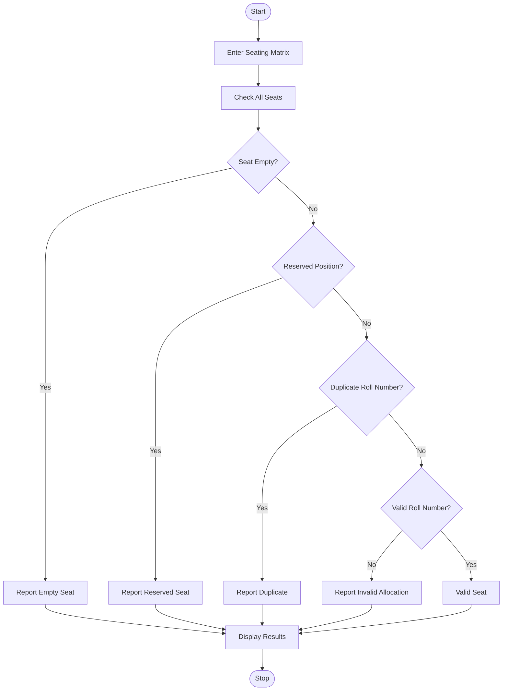

## 1. PROBLEM STATEMENT
To validate an examination seating matrix using nested lists. The program checks duplicate roll numbers, reserved positions, empty seats, and invalid student allocations.
## 2. ALGORITHM
1. Start the program.
2. Create a nested list representing the seating arrangement.
3. Enter roll numbers in each seat.
4. Check for empty seats and reserved positions.
5. Check for duplicate roll numbers.
6. Identify invalid student allocations.
7. Display the validation results.
8. Stop the program.
## 3. FLOWCHART 

## 5. SAMPLE INPUT
[[101, 102, 0],
 [103, 101, 105]]
## 6. SAMPLE OUTPUT
Valid: 101
Valid: 102
Reserved: 0 2
Valid: 103
Duplicate: 101
Valid: 105
