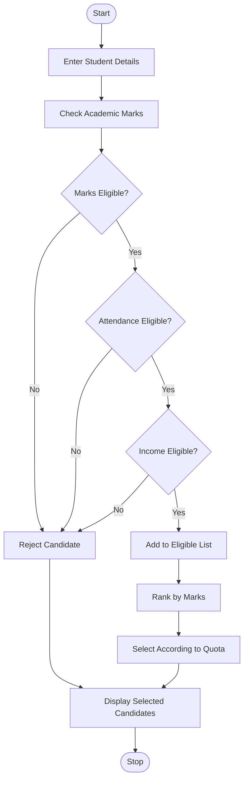

## 1. PROBLEM STATEMENT
To select scholarship candidates by checking academic marks, attendance, and family income. The program identifies eligible students, ranks them based on marks, and selects candidates according to a fixed scholarship quota.
## 2. ALGORITHM
1. Start the program.
2. Enter student names, marks, attendance, and family income.
3. Set minimum eligibility conditions.
4. Check academic marks.
5. Check attendance and income requirements.
6. Identify eligible candidates.
7. Rank candidates according to marks.
8. Select students within the scholarship quota.
9. Display selected candidates.
10. Stop the program.
## 3. FLOWCHART 

## 5. SAMPLE INPUT
Asha: Marks=90, Attendance=85, Income=100000
Ravi: Marks=80, Attendance=90, Income=150000
Priya: Marks=95, Attendance=95, Income=80000
John: Marks=60, Attendance=70, Income=200000
Scholarship Quota: 2
## 6. SAMPLE OUTPUT
Eligible:
[('Asha', 90), ('Ravi', 80), ('Priya', 95)]
Scholarship Selected:
('Priya', 95)
('Asha', 90)
