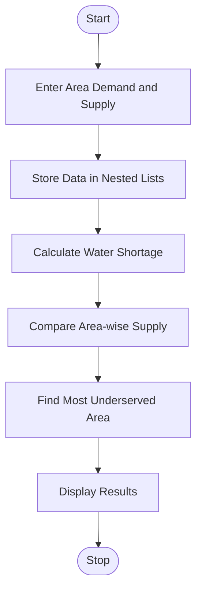

## 1. PROBLEM STATEMENT
To analyse area-wise water distribution over several days. The program calculates water shortages by comparing demand with actual supply, compares distribution levels, and identifies the most underserved area.
## 2. ALGORITHM
1. Start the program.
2. Enter the water demand and supply for each area.
3. Store the values using nested lists.
4. Calculate the shortage for each area.
5. Compare water supply levels.
6. Identify the most underserved area.
7. Display shortages and results.
8. Stop the program.
## 3. FLOWCHART 

## 5. SAMPLE INPUT
Area A: Demand = [100, 120], Supply = [80, 100]
Area B: Demand = [150, 160], Supply = [100, 110]
Area C: Demand = [130, 140], Supply = [120, 130]
## 6. SAMPLE OUTPUT
Area A Shortage: 40
Area B Shortage: 100
Area C Shortage: 20
Most underserved area: Area B

