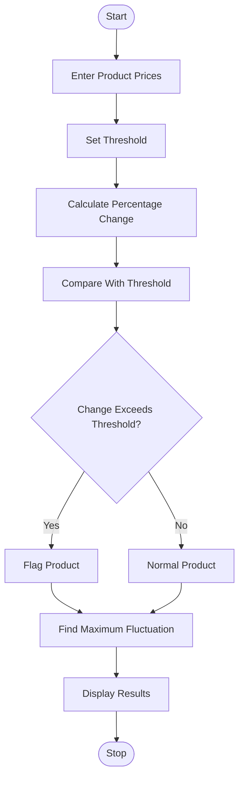

## 1. PROBLEM STATEMENT
To analyse historical prices of multiple products using lists. The program calculates percentage price changes, identifies maximum fluctuations, and flags products whose price changes exceed the given threshold.
## 2. ALGORITHM
1. Start the program.
2. Enter product names and historical prices.
3. Calculate percentage price changes.
4. Compare price changes with the threshold.
5. Identify maximum price fluctuation.
6. Flag products exceeding the threshold.
7. Display the results.
8. Stop the program.
## 3. FLOWCHART 

## 5. SAMPLE INPUT
Laptop: [1000, 1200]
Phone: [800, 760]
Tablet: [500, 600]
Threshold: 15
## 6. SAMPLE OUTPUT
Laptop Change: 20.0 %
Flagged
Phone Change: -5.0 %
Tablet Change: 20.0 %
Flagged
Maximum fluctuation: Laptop
Products with more than 15% fluctuation are flagged.
