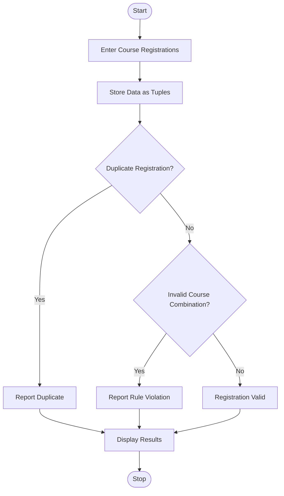

## 1. PROBLEM STATEMENT
To validate course registrations using tuples. The program identifies duplicate registrations, checks invalid course combinations, and finds students whose course selections violate the given rules.
## 2. ALGORITHM
1. Start the program.
2. Store student registrations as tuples.
3. Check for duplicate registrations.
4. Check invalid course combinations.
5. Identify students violating the rules.
6. Display the validation results.
7. Stop the program.
## 3. FLOWCHART 

## 5. SAMPLE INPUT
(101, "Python")
(102, "Java")
(101, "Python")
(103, "Python")
## 6. SAMPLE OUTPUT
Valid: 101 Python
Valid: 102 Java
Duplicate: 101 Python
Valid: 101 Python
Valid: 103 Python

Student 101 is not allowed to register for Java according to the given rule.
