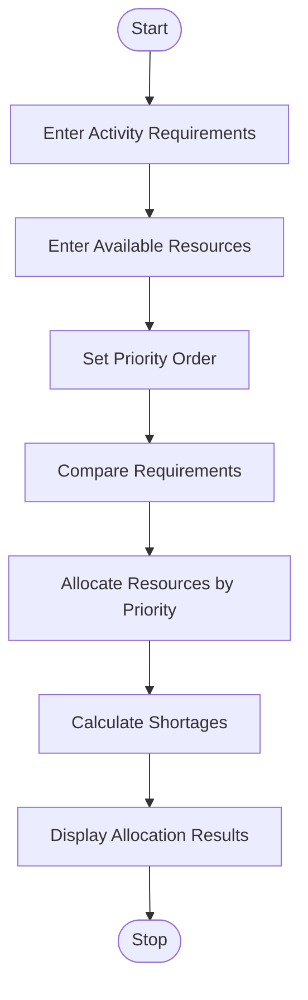

## 1. PROBLEM STATEMENT
To allocate campus resources among multiple activities based on equipment requirements and available resources. The program calculates shortages and distributes resources according to a specified priority order.
## 2. ALGORITHM
1. Start the program.
2. Enter activity names and equipment requirements.
3. Enter the available resources.
4. Set the priority order of activities.
5. Compare requirements with available resources.
6. Allocate resources according to priority.
7. Calculate shortages for each activity.
8. Display the allocation and shortages.
9. Stop the program.
## 3. FLOWCHART (MERMAID)

## 5. SAMPLE INPUT
Activities: Sports, Library, Lab
Demand: [50, 30, 40]
Available Resources: 90
Priority: Sports, Library, Lab
## 6. SAMPLE OUTPUT
Sports Allocated: 50 Shortage: 0
Library Allocated: 30 Shortage: 0
Lab Allocated: 10 Shortage: 30
Remaining resources: 0

The allocation does not exceed the available resources.
