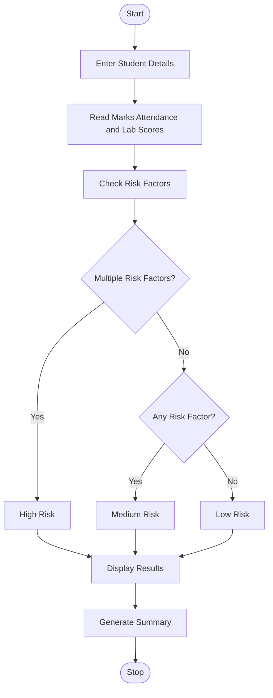

## 1. PROBLEM STATEMENT
To classify students into academic risk categories using marks, attendance, and laboratory scores. The program identifies multiple risk factors, classifies students as low, medium, or high risk, and generates a summary.
## 2. ALGORITHM
1. Start the program.
2. Enter student names, marks, attendance, and laboratory scores.
3. Store the details in lists.
4. Check marks, attendance, and laboratory scores.
5. Identify risk factors.
6. Classify students into risk categories.
7. Display student risk details.
8. Generate a summary.
9. Stop the program.
## 3. FLOWCHART

## 5. SAMPLE INPUT
Asha: Marks=35, Attendance=60, Lab=30
Ravi: Marks=75, Attendance=90, Lab=80
Priya: Marks=45, Attendance=70, Lab=40
## 6. SAMPLE OUTPUT
Asha Risk: High Factors: 3
Ravi Risk: Low Factors: 0
Priya Risk: Medium Factors: 1
High risk students: 1

Two or more risk factors indicate High Risk.
