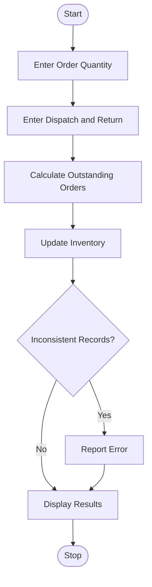

## 1. PROBLEM STATEMENT
To analyse retail orders, dispatch records, and returned quantities. The program calculates outstanding orders, updates available inventory, and identifies inconsistent records.
## 2. ALGORITHM
1. Start the program.
2. Enter order quantities.
3. Enter dispatched and returned quantities.
4. Calculate outstanding orders.
5. Update inventory after returns.
6. Check for inconsistent records.
7. Display outstanding orders and inventory.
8. Stop the program.
## 3. FLOWCHART 

## 5. SAMPLE INPUT
Orders:     [100, 80, 120]
Dispatched: [80, 70, 130]
Returned:   [10, 5, 10]
Inventory:  [50, 40, 60]
## 6. SAMPLE OUTPUT
Outstanding: 20 Inventory: 60
Outstanding: 10 Inventory: 45
Inconsistent Record: 3
Order Analysis Completed

If dispatched quantity exceeds order quantity or returned quantity exceeds dispatched quantity, the record is inconsistent.
