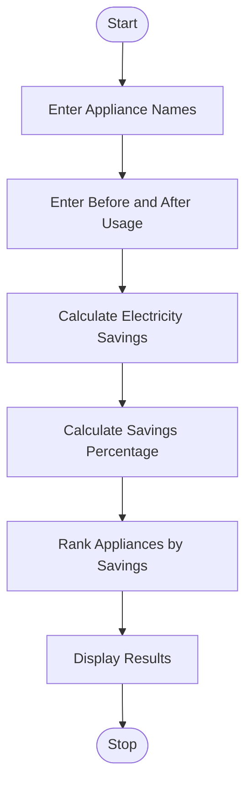

## 1. PROBLEM STATEMENT
To compare appliance-wise electricity consumption before and after an energy conservation intervention. The program calculates electricity savings percentages and ranks appliances based on their achieved savings.
## 2. ALGORITHM
1. Start the program.
2. Enter appliance names.
3. Enter electricity usage before and after intervention.
4. Calculate electricity savings.
5. Calculate savings percentage.
6. Rank appliances based on savings.
7. Display savings and rankings.
8. Stop the program.
## 3. FLOWCHART 

## 5. SAMPLE INPUT
Fan: Before = 100, After = 70
AC: Before = 300, After = 180
Light: Before = 80, After = 40
## 6. SAMPLE OUTPUT
Fan Savings: 30.0 %
AC Savings: 40.0 %
Light Savings: 50.0 %
Ranking:
[('Light', 50.0),
 ('AC', 40.0),
 ('Fan', 30.0)]
