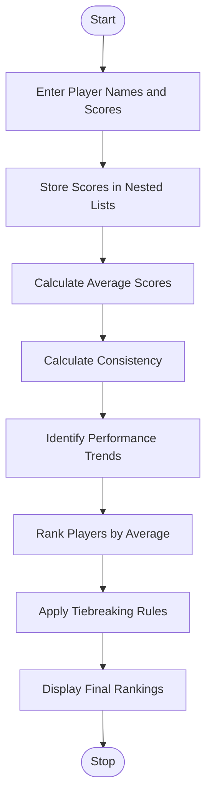

## 1. PROBLEM STATEMENT
To analyse players' scores across multiple matches using nested lists. The program calculates average scores, measures consistency, identifies performance trends, and ranks players based on average scores. In case of a tie, the highest individual score is used as a tiebreaker.
## 2. ALGORITHM
1. Start the program.
2. Enter player names and match scores.
3. Store scores using nested lists.
4. Calculate each player's average score.
5. Calculate score consistency.
6. Identify performance trends.
7. Rank players using average scores.
8. Apply highest score as a tiebreaker.
9. Display the results.
10. Stop the program.
## 3. FLOWCHART 

## 5. SAMPLE INPUT
Asha:  [50, 60, 70]
Ravi:  [80, 70, 90]
Priya: [60, 60, 60]
## 6. SAMPLE OUTPUT
Asha Average: 60.0 Range: 20 Improving
Ravi Average: 80.0 Range: 20 Improving
Priya Average: 60.0 Range: 0 Stable
Final Ranking:
1 Ravi 80.0
2 Asha 60.0
3 Priya 60.0

Players are ranked by average score; highest individual score breaks ties.
